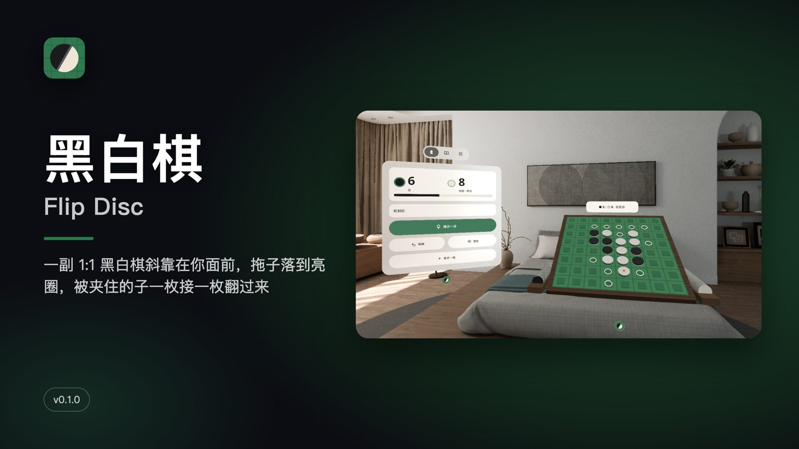
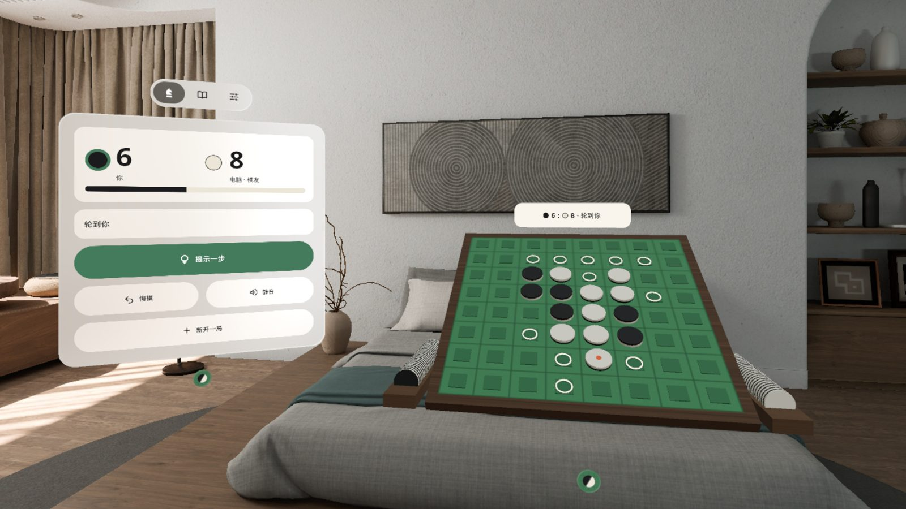
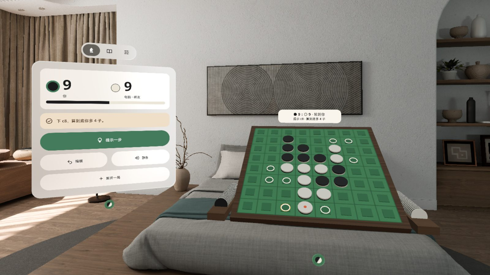
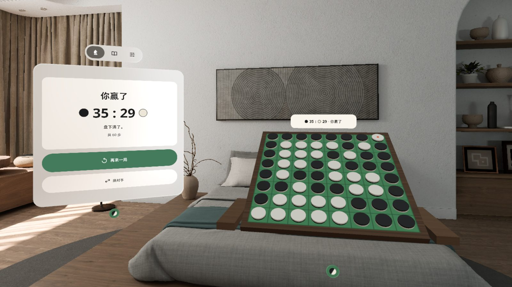
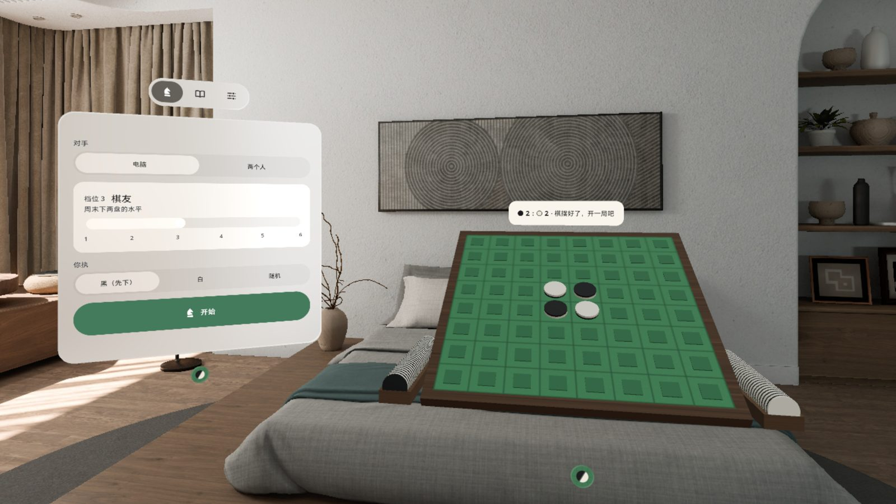
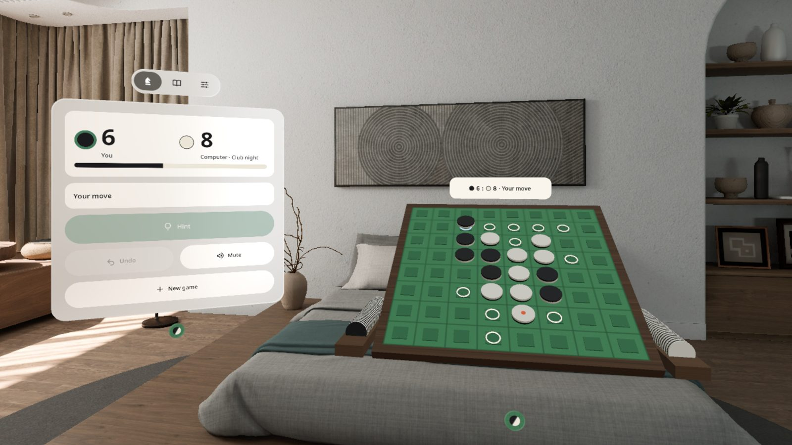
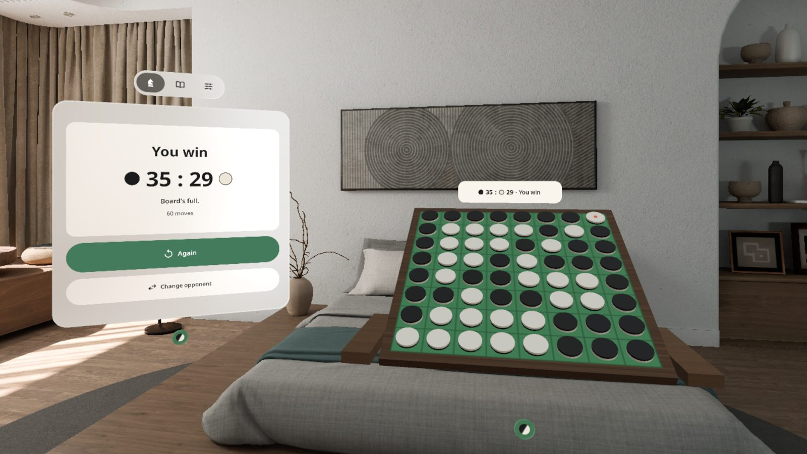
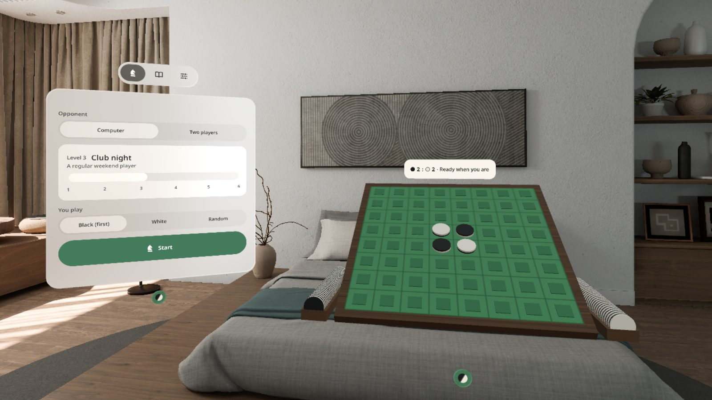

# 黑白棋 Flip Disc



**中文** · [English](#english)

一副 1:1 的黑白棋斜靠在你面前：8×8 绿绒面棋盘，厚厚的双面子。从自己的棋槽里捏起一枚，拖到亮圈上松手（或者直接点亮圈），被夹住的子一枚接一枚真的翻过来。六档电脑对手，从「刚上手」到「大师」；也能两个人轮流戴同一台头显下。中英双语，全部本机运行，不联网、不需要账号。

适用于 PICO OS 6 Shared Space（PICO Spatial SDK 6.1.9，SpatialUI + PicoTheme，Kotlin）。

## 截图

截图都在 PICO 模拟器里拍（HD 2560，中文界面），棋局由调试命令摆好。

| | |
|---|---|
|  轮到你：能落的格子亮圈，席位牌显示比分 |  从棋槽拖一枚子，对上合法格就吸住 |
|  被夹住的子按距离一枚接一枚翻过来 |  提示一步：实线琥珀环 = 有把握的好棋 |
|  盘满数子，大字结果 + 再来一局 |  开局设置：电脑六档 / 两人同机、执黑执白 |

## 怎么玩

- **落子**：从自己的棋槽（左黑右白）捏起一枚，拖到亮圈上松手；或者直接点亮圈。手柄射线、手势射线 + 捏合、眼看 + 捏合三种输入都行。
- **翻面**：所有被夹住的方向都翻，按离落点的距离一枚接一枚翻。
- **没棋可下**：自动跳过（pass），提示一下由对方接着走。盘满或双方都没棋时数子，多的赢。
- **控制窗**三个页签：对局（比分 / 提示一步 / 悔棋 / 静音 / 新开一局）、规则（规则图 + 怎么操作）、设置（音量四档、棋盘角度 20–90°、语言、重开控制窗、重置进度、退出应用）。
- 有进行中的对局时，新开一局 / 重置 / 退出都会先确认，进度自动保存。

## 安装

从 [Releases](https://github.com/kejing-dev/FlipDisc/releases) 下载 `FlipDisc-v0.1.0.apk`（assembleRelease 出的未签名包，供 Vibe Lab 平台重签名；自己装到头显请用本仓库自己构建的 debug 包）：

```bash
./gradlew assembleDebug
adb install -r app/build/outputs/apk/debug/app-debug.apk
pico-cli app launch io.embodit.flipdisc
```

构建、调试命令、截图说明见 [AGENTS.md](AGENTS.md)。

## 说明

- 演示视频和截图由调试命令驱动（模拟器里无法注入真实手势），**非真实手势录像**。
- v0.1.0 在模拟器上完成 QA；三种输入的手感、射线、启动摆位还待真机验证。
- 声音：CC0 实录（freesound Hongsungbock 840425、Kenney interface sounds）。图标：Material Symbols（Apache-2.0）。字体：Noto Sans（OFL）。

---

## English

A real-size Reversi set leaning toward you in PICO OS 6 Shared Space: an 8×8 green felt board with thick two-colour discs. Pinch a disc out of your tray and drop it on a lit ring (or just tap the ring), and every disc you trapped flips over, one after another. Six computer levels from Rookie to Master, or two players taking turns with one headset. Chinese / English, fully offline, no account.

Built with PICO Spatial SDK 6.1.9, SpatialUI + PicoTheme, Kotlin.

### Screenshots

Captured in the PICO emulator (HD 2560, English UI); positions were set up with debug commands.

| | |
|---|---|
|  Your move: legal squares light up |  Drag a disc from the tray; it snaps onto a legal square |
|  Trapped discs flip one after another |  Hint: a solid amber ring marks a confident move |
|  Board full: big result and score |  Setup: six AI levels or two players |

### How to play

- **Place**: pinch a disc out of your tray (black left, white right) and drop it on a lit ring, or tap the ring. Controller ray, hand ray + pinch and gaze + pinch all work.
- **Flip**: every trapped line flips, disc by disc, by distance from the new disc.
- **Pass**: if you have no legal move the turn passes automatically. When the board is full or neither side can move, the side with more discs wins.
- **Control window**, three tabs: Play (score, hint, undo, mute, new game), Rules (rules + how to play), Settings (4-step volume, board tilt 20–90°, language, reopen panel, reset progress, quit).
- New game / reset / quit ask first when a game is in progress; progress is saved.

### Install

Download `FlipDisc-v0.1.0.apk` from [Releases](https://github.com/kejing-dev/FlipDisc/releases) (unsigned `assembleRelease` build for platform re-signing; to sideload, build the debug APK yourself):

```bash
./gradlew assembleDebug
adb install -r app/build/outputs/apk/debug/app-debug.apk
pico-cli app launch io.embodit.flipdisc
```

Build, debug commands and screenshot notes: [AGENTS.md](AGENTS.md).

### Notes

- The demo video and screenshots are driven by debug commands in the emulator — **not a recording of real hand input**.
- v0.1.0 passed QA on the emulator; input feel, rays and launch placement are still to be checked on a headset.
- Sounds: CC0 recordings (freesound Hongsungbock 840425, Kenney interface sounds). Icons: Material Symbols (Apache-2.0). Font: Noto Sans (OFL).
